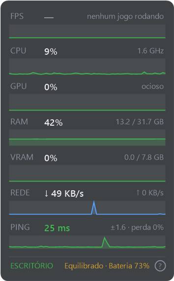

# TurboHUD

Overlay leve de desempenho para Windows, feito para ficar no canto da tela durante jogos: FPS e latência, CPU, GPU, RAM, VRAM, rede, ping e modo de energia. Um único arquivo C#, compilado com o `csc.exe` que já vem no Windows. Sem instalar .NET, Visual Studio ou nada além dele.

Em notebooks **Avell** com o Avell Custom Control (o Control Center 3 da Uniwill), o **Ctrl+Alt+T** troca o modo de desempenho do próprio notebook (Escritório ↔ Turbo), o mesmo que o painel da Avell faz, sem precisar abri-lo durante o jogo.

<p align="center"></p>

## O que mostra

| Linha | Origem |
| --- | --- |
| FPS e latência do app em foco | [PresentMon](https://github.com/GameTechDev/PresentMon) (Intel), opcional |
| CPU: uso e GHz | Contadores de desempenho do Windows |
| GPU: uso e temperatura | Contadores do Windows; temperatura pela NVML (NVIDIA), lida só com a GPU já ativa para não acordar a placa dedicada |
| RAM e VRAM | Windows |
| Rede: download e upload | Contadores do Windows |
| Ping, variação e perda | Ping a cada segundo para 1.1.1.1 (ou outro host passado como argumento) |
| Rodapé | Modo da Avell (ESCRITÓRIO / GAMING / TURBO) ou, sem a Avell, se o turbo do processador está ligado no plano de energia; plano ativo; tomada ou bateria |

Consumo medido: ~0,03% de CPU e ~55 MB de RAM com o widget visível. Escondido, as medições param e ele só escuta os atalhos.

## Atalhos

Funcionam dentro de jogos (o widget não precisa estar em foco):

| Atalho | Ação |
| --- | --- |
| Ctrl+Alt+M | Mostra / esconde o widget |
| Ctrl+Alt+N | Move para o próximo monitor (a escolha fica salva) |
| Ctrl+Alt+G | Liga / desliga os gráficos dos últimos 60 s |
| Ctrl+Alt+T | Escritório ↔ Turbo (ver abaixo) |

Passar o mouse no "?" do rodapé mostra os atalhos. Abrir o `.exe` de novo também mostra/esconde.

### Ctrl+Alt+T

- **Com o Avell Custom Control instalado:** troca o modo da Avell entre Escritório e Turbo. Num Storm 460, Escritório limita a CPU a 45 W e Turbo libera 140/165 W. O painel da Avell, se estiver aberto, acompanha a troca.
- **Junto, o plano de energia do Windows:** se existir um plano chamado **Jogos**, o atalho alterna entre ele e o Equilibrado. O modo da Avell e o plano do Windows são independentes: um plano que desliga o boost do processador anula o Turbo da Avell.
- **Sem a Avell:** troca só o plano (Jogos ↔ Equilibrado).

Como a troca do modo da Avell funciona por dentro: [docs/avell-custom-control.md](docs/avell-custom-control.md).

## Instalar

Requisitos: Windows 10 ou 11 (64 bits). O .NET Framework 4.x já vem no Windows.

```powershell
git clone https://github.com/hugogontijomachado/turbo-hud.git
cd turbo-hud
powershell -ExecutionPolicy Bypass -File instalar.ps1
```

O `instalar.ps1` compila, copia para `%LOCALAPPDATA%\TurboHUD` e cria o atalho **TurboHUD** na Área de Trabalho. Se o widget estiver aberto, ele fecha antes de substituir. Opções:

- `-PresentMon <caminho do PresentMon-x.y.z-x64.exe>`: copia o PresentMon para medir FPS. Baixe a versão de console em [PresentMon releases](https://github.com/GameTechDev/PresentMon/releases); o instalador confere a assinatura da Intel.
- `-Inicializacao`: inicia o widget escondido junto com o Windows, para os atalhos funcionarem sempre.

### FPS sem rodar como administrador

O PresentMon precisa de admin ou do grupo **Usuários de log de desempenho**. Para usar sem admin, rode uma vez num PowerShell como administrador e depois saia e entre de novo no Windows:

```powershell
Add-LocalGroupMember -SID S-1-5-32-559 -Member $env:USERNAME
```

### Argumentos do .exe

- `--oculto`: inicia escondido.
- `--sair`: fecha a instância aberta.
- Qualquer outro argumento é o host do ping (padrão `1.1.1.1`).

## Limitações

- Jogos em tela cheia exclusiva cobrem o widget; use "janela sem bordas".
- O FPS é do app em foco que renderiza a 20 FPS ou mais. Ao sair do jogo, continua mostrando o último enquanto ele renderizar.
- A integração com a Avell foi testada só num Storm 460 com o Avell Custom Control 5.24.50.3.

## Ferramentas

- [ferramentas/mqtt-avell.ps1](ferramentas/mqtt-avell.ps1): ouve o canal interno do Avell Custom Control e manda comandos. `-Acao GETSTATUS -Topico Fan/Status` mostra o modo e os limites de potência atuais.
- [ferramentas/atalho-widget.ps1](ferramentas/atalho-widget.ps1): simula Ctrl+Alt+<tecla> para testar os atalhos.

## Aviso

Projeto pessoal, sem ligação com a Avell ou a Uniwill. A troca de modo usa o mesmo comando que o painel oficial manda, mas não é suportada pelo fabricante. O modo Turbo aumenta potência, temperatura e ruído. Use por sua conta e risco.

## Licença

[MIT](LICENSE).
